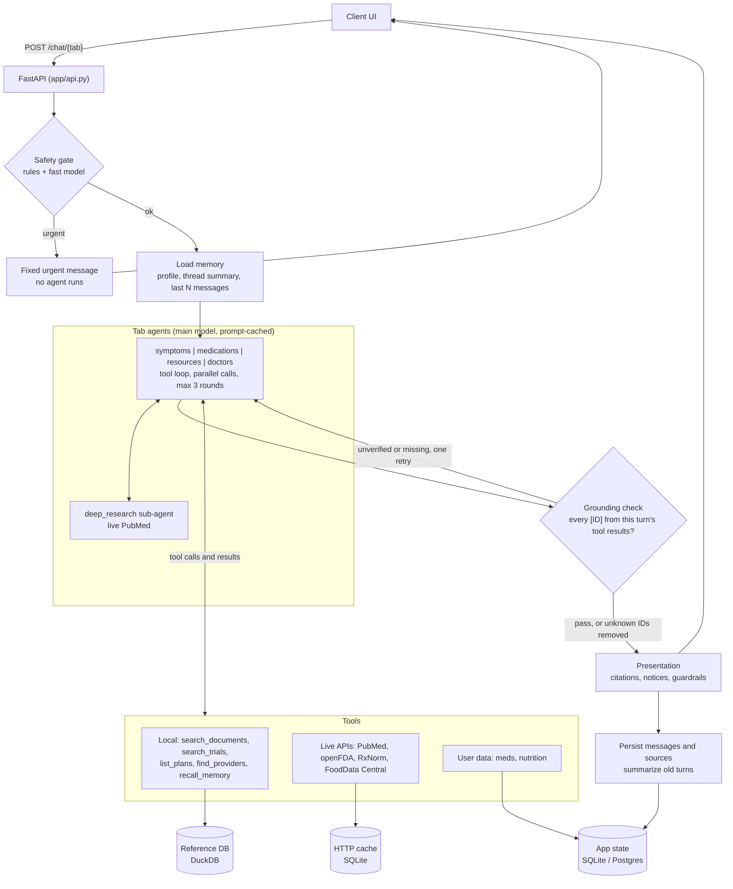

# Kidney Women's Health Assistant

A multi-agent backend that gives women living with kidney disease (CKD, dialysis, transplant) a place to ask
health questions, check medications, find coverage and doctors, and prepare for visits. Every answer is
grounded in real sources, passes a safety gate, and carries citations the user can open.

> **Status: hackathon prototype.** It provides general health education, not medical advice. See
> [Before real users](#before-real-users).

## The problem

Women with kidney disease face questions that general health apps and search engines handle badly:

- **Kidney disease, pregnancy, and medications interact.** Many common drugs (ACE inhibitors, tacrolimus, and others)
  carry pregnancy or breastfeeding warnings, and the answer depends on CKD stage, dialysis, or transplant status.
- **Reliable information is scattered** across FDA labels, adverse-event reports, PubMed, ClinicalTrials.gov, insurer
  plans, and provider directories.
- **Chatbots can invent facts and citations.** In a health setting, a made-up reference or a dosing instruction is dangerous.
- **Some messages are emergencies** (preeclampsia signs, missed dialysis with chest symptoms, crisis language) and must
  not be answered by a chatbot at all.
- **Appointments are short.** Patients often forget their medication list, symptoms, and questions.
- **Health data is sensitive** and should not be kept longer than needed.

## The solution

Four specialist chat agents (tabs) share one memory layer, one safety gate, one citation checker, and a shared
research sub-agent. A "You" area holds the user's own data: pinboard, medications, nutrition, and visit prep.

### Architecture



Every source found in a turn is saved, so any tab can recall it later.

| Tab | What it does | Tools |
|---|---|---|
| symptoms | Symptoms and self-management from research | `search_documents`, `deep_research` (live PubMed sub-agent), `recall_memory`, `my_nutrition` |
| medications | Label, FAERS, and patient-experience view of a drug | `normalize_drug` (RxNorm), `drug_label` + `faers_summary` (openFDA), `drug_signal_profile`, `patient_reviews`, `check_my_interactions`, `search_documents`, `deep_research`, `recall_memory` |
| resources | Coverage, plans, clinical trials, and rides to care (California) | `search_documents`, `search_trials` (ClinicalTrials.gov), `list_plans`, `ride_help`, `recall_memory` |
| doctors | In-network providers near the user | `list_plans`, `find_providers` (NPPES + insurer directories), `recall_memory` |

## Features

### Safety and trust
- **Safety gate** runs before any agent. Deterministic rules plus an optional fast-model check catch crisis language,
  pregnancy warning signs, and kidney emergencies, and return a fixed message instead of an answer.
- **Citation grounding.** Every `[ID]` in an answer must come from that turn's tool results. Unknown IDs are removed.
- **Evaluator-optimizer.** The deterministic citation check is the evaluator. If the draft cited IDs that no tool
  returned, or a symptoms/medications answer has no citations, the agent gets one retry with specific feedback, the
  full conversation including tool results, and one extra tool round. The revision is kept only if it fixes the
  problem without adding new unverified citations; otherwise the original is kept and cleaned. `MAX_REVISIONS=0`
  disables it, and the eval scorecard reports revision rate and accept/reject counts so you can A/B it.
- **Dosing guard.** Personal dosing instructions are detected and flagged.
- **Visible guardrails.** Each response lists the checks that ran so the UI can show them (see [API](#api)).

### Drug signal profile (`app/tools/signals.py`)
`drug_signal_profile(drug, condition?)` is the medications agent's first call for side-effect questions. It builds
one table across sources, in code:

| Theme | Patient reviews (her condition) | FAERS reports, women | On FDA label? (with sentence) |
|---|---|---|---|

Each theme is classified as `on_label_and_reported`, `reported_not_on_label` (PubMed is checked automatically for the
top 2, with a deterministic query, and PMIDs are returned), or `label_only`. Matching uses fixed vocabularies (review
phrasing + MedDRA/label terms), so the same drug always gives the same table. If no label is found, nothing is
called "not on label". FAERS isn't filtered by condition (it covers all uses of the drug).

### Patient reviews (`app/tools/reviews.py`, `ingest/reviews.py`)
- Load-time cleaning: usernames dropped; scrape debris cut from ~4,400 reviews; brand-prefixed condition labels
  merged ("Prograf (tacrolimus) for Organ Transplant" -> "Organ Transplant").
- `patient_reviews(drug, condition?)` searches the ingredient plus all brand names via RxNorm, removes duplicates
  listed under both, splits by condition (e.g. topical tacrolimus for eczema vs transplant), counts side-effect
  themes, flags pregnancy/birth/breastfeeding mentions, and returns short excerpts.
- Always shown as "personal experiences": never how common an effect is, never evidence a drug works, and
  reviewers' sex isn't recorded. Credit the dataset in the UI wherever review data appears.

### The You tab (`app/you/`)
Three windows: **Pinboard**, **My medications**, **Nutrition**. `GET /you/{user_id}` returns all three for the
tab's first load.

**Medications** (`POST /you/meds`, `PATCH|DELETE /you/meds/{id}`, `POST /you/meds/{id}/dose`)
- Users enter name, dose exactly as prescribed, and times (HH:MM, local). Names are normalized with RxNorm.
  The app never sets or changes doses.
- Reminders: a loop checks every minute and POSTs due reminders to `REMINDER_WEBHOOK_URL` (your email/SMS/push
  relay). Text is generic ("Time for your 8:00 AM medications") so drug names never show on a lock screen. Set the
  user's `timezone` in her profile.
- Interactions (`GET /you/{user_id}/interactions?drug=…`): flags pairs whose FDA label Drug Interactions /
  Contraindications / Boxed Warning sections name the other drug or its FDA pharmacologic class, quoting the
  sentence with a citation. FAERS "reported together" counts are context only. NLM's interaction API was
  discontinued in 2024. A label only catches what it names: always show the notices.

**Nutrition** (`POST /you/meals`, `GET /you/{user_id}/nutrition?day_from=…&day_to=…`)
- Free-text meals -> fast model estimates foods and grams -> USDA FoodData Central nutrients. Tracks sodium,
  potassium, phosphorus, protein, and fluids. No calories or weight. Compares only against targets she enters from
  her dietitian (`nutrition_targets` in profile).

**Visit prep** (`POST /you/visit-prep {user_id, visit_type, concerns?, days?, save?}`, in `app/you/visit_prep.py`)
- `visit_type` is `pcp | obgyn | nephrology | maternal_fetal_medicine`. Returns a printable sheet (`markdown`) plus
  structured fields.
- **Facts are built by code** from her own entries: profile, medications exactly as entered, doses she marked,
  nutrition averages vs her dietitian's targets, and FDA-label interaction flags with the quoted sentence.
- **Questions are written by the model** from her concerns, recent chat questions, pins, the facts, and a curated
  standard list per visit type (OB/GYN and nephrology lists change with pregnancy status). Each question must state
  what it's based on; invented references and anything with dosing language are dropped; each interaction flag always
  gets a question; if the model fails, the curated list is used.
- `save: true` pins the sheet to her board.

### Ride finder (`app/tools/transport.py`)
A step-by-step Medi-Cal ride finder (NMT/NEMT), available as the chat tool `ride_help` and as
`POST /resources/ride {answers}` for the "Get a ride" card flow. Each call returns either the next question or a
result card: ZIP -> county (asked only if the ZIP spans counties) -> coverage -> Medi-Cal plan -> destination ->
mobility. The card says who to call, gives a call script and requirements (NEMT needs a prescription; for NMT, say
there's no other way to get there; for dialysis, ask for standing rides), and lists fallbacks (paratransit,
American Kidney Fund, 211). Rules come from DHCS pages. Pregnancy and postpartum status come from the profile,
because they change NMT eligibility. A phone number gets a call button **only** if a teammate has verified it
(`last_verified` in `data/raw/ca_medi_cal_plans.csv`); otherwise the card links the DHCS plan directory.
Verified plans can list extra language lines (`other_phones`). If she isn't sure of her plan, the card adds
Medi-Cal Health Care Options (the plan enrollment line) as an alternate contact.

### Privacy and retention
| Data | Kept |
|---|---|
| Chats | 30 days after last use (`RETENTION_DAYS`) |
| Meal and dose logs | 90 days (`LOG_RETENTION_DAYS`) |
| Medication list | until removed |
| Pins | until unpinned |

The purge runs at startup and daily (or `python -m app.retention` from cron). `GET /retention` returns the text to
show in the UI. `DELETE /threads/{id}?user_id=` deletes one chat; `DELETE /users/{id}/data` erases everything for a user.

## Data sources

**Live APIs** (queried at answer time, responses cached in `data/http_cache.sqlite`)

| Source | Used for | Cache TTL | Key |
|---|---|---|---|
| [PubMed / NCBI E-utilities](https://eutils.ncbi.nlm.nih.gov/entrez/eutils) | `deep_research` literature sub-agent, reported-not-on-label checks | 3 days | `NCBI_API_KEY` (optional) |
| [openFDA drug labels](https://api.fda.gov/drug), linked to [DailyMed](https://dailymed.nlm.nih.gov) | Boxed warnings, interactions, contraindications, pregnancy and lactation text | 7 days | `OPENFDA_API_KEY` (optional) |
| [openFDA FAERS](https://open.fda.gov/data/faers/) | Adverse-event report counts, split by sex | 7 days | `OPENFDA_API_KEY` (optional) |
| [RxNorm / RxNav](https://rxnav.nlm.nih.gov/REST) | Drug name normalization, brand names, pharmacologic classes | 30 days | none |
| [USDA FoodData Central](https://api.nal.usda.gov/fdc/v1/foods/search) | Nutrient values for logged meals | 90 days | `FDC_API_KEY` (`DEMO_KEY` is rate-limited) |

**Reference data** (downloaded or supplied once, loaded by `ingest/` into `data/reference.duckdb`)

| Source | Loaded by | Contents |
|---|---|---|
| Curated documents (`manifest.csv`, see `manifest_template.csv`) | `ingest.documents` | Research, coverage, and resource articles searched by `search_documents` |
| `data/raw/resources_manifest.csv` | `ingest.documents` | California and federal coverage pages and support resources, plus patient education on CKD, AKI, kidney infections, glomerular disease, women's kidney health, menopause, pregnancy, and medicines |
| `data/raw/literature.csv`: the team's core papers (KDIGO 2025 consensus, AHA 2026 statement, pregnancy-outcome reviews, disparities and cardiometabolic papers) | `ingest.documents --literature` (`ingest/literature.py`) | PubMed abstracts only. Each entry's real PubMed title must match its expected title, so a typo'd PMID can't load the wrong paper; skipped entries are listed in `data/literature_report.csv` |
| [Census ZCTA-to-county relationship file](https://www.census.gov/geographies/reference-files/time-series/geo/relationship-files.html) | `ingest.ca_transport` | California ZIP -> county for the ride finder |
| `data/raw/ca_medi_cal_plans.csv` from the [DHCS plan directory](https://www.dhcs.ca.gov/individuals/medi-cal-managed-care-health-plan-directory/) | read directly by `app/tools/transport.py` | Medi-Cal plans per county with verified phone numbers (see `ca_medi_cal_plans_README.md`) |
| [ClinicalTrials.gov API v2](https://clinicaltrials.gov/api/v2/studies) | `ingest.clinicaltrials` | Recruiting trials for `search_trials` |
| [CMS NPPES NPI file](https://download.cms.gov/nppes/NPI_Files.html) | `ingest.providers` | National provider registry, monthly V.2 file (`npidata_pfile_*.csv`, ~10 GB; V.1 headers also work) |
| [Census Gazetteer ZCTA file](https://www.census.gov/geographies/reference-files/time-series/geo/gazetteer-files.html) (e.g. `2026_Gaz_zcta_national.txt`) | `ingest.providers` | ZIP code coordinates for distance search |
| Insurance plans CSV (see `data/raw/plans_template.csv`) | `ingest.providers` | Plans the user can select |
| Insurer provider-directory PDFs (`data/raw/Provider_Directory/`, listed in `directories.csv`) | `ingest.directories --batch` | In-network status, matched to NPPES providers; until loaded, the doctor finder returns the plan's official provider-search link from `plans.csv` |
| [DrugRev](https://doi.org/10.17632/64cc5w5dxy.1) (Ahmed et al., 2023, Mendeley Data, CC BY 4.0) | `ingest.reviews` | Drugs.com patient reviews, 2008-2023 (~170 MB, not bundled) |

User-entered data (profile, medications, meals, dietitian targets) is stored separately as app state: SQLite locally,
Postgres via `DATABASE_URL`.

## Tech stack

| Layer | Technology |
|---|---|
| Language | Python |
| API | FastAPI, Uvicorn, Pydantic |
| LLMs | Main model for answers, fast model for safety checks, summaries, and extraction (`MODEL_MAIN`, `MODEL_FAST`). Nebius Token Factory is the default (OpenAI-compatible, via the `openai` SDK); Anthropic is opt-in via `LLM_PROVIDER=anthropic` |
| Reference data | DuckDB (read-only, BM25 search) |
| App state | SQLite locally, Postgres in deployment (SQLAlchemy, psycopg) |
| Ingestion | pandas, pyarrow, pdfplumber |
| Testing and eval | pytest, PyYAML |
| Deployment | Docker Compose (API + Caddy for HTTPS) on a Nebius VM; Base44 frontend and login (Deno backend functions) |

## Project structure

```
kidney_app/
├── app/                      # the service
│   ├── api.py                # FastAPI routes, background purge and reminder loops
│   ├── orchestrator.py       # per-turn pipeline: safety -> agent -> grounding -> persist
│   ├── agents.py             # the four tab agents: prompts and tool sets
│   ├── safety.py             # safety gate: rules + fast-model check, fixed urgent messages
│   ├── grounding.py          # citation checking and self-correction
│   ├── presentation.py       # answer_display, citations, notices, guardrail summaries
│   ├── appstate.py           # profiles, threads, messages, pins (SQLite / Postgres)
│   ├── refdb.py              # DuckDB reference data access and BM25 search
│   ├── cache.py              # persistent HTTP response cache
│   ├── retention.py          # data expiry (also runnable from cron)
│   ├── llm.py                # get_client(): Nebius by default; Anthropic only when explicitly selected
│   ├── security.py           # shared-secret check + per-user rate limiting
│   ├── config.py             # all settings, overridable by environment variable
│   ├── tools/                # agent tools: local, external (PubMed/openFDA/RxNav/...), reviews, signals, transport
│   └── you/                  # personal features: meds, nutrition, visit_prep
├── ingest/                   # offline loaders that build the reference DB
│   └── documents.py  literature.py  clinicaltrials.py  providers.py  directories.py  ca_transport.py  reviews.py
├── eval/                     # evaluation harness
│   ├── run.py  components.py  judge.py  metrics.py  scorecard.py  calibrate.py  config.yaml
│   └── datasets/             # golden, red-team, safety, retrieval, scenarios, personas, labels
├── tests/                    # one test_*.py per area, incl. test_llm_adapter and test_security
├── src/  index.html  package.json  vite.config.js   # React (Vite) frontend; see FRONTEND.md
├── base44/                   # Base44 frontend: proxy + reminder-relay functions, FRONTEND_SPEC.md
├── deploy/                   # Caddyfile, VM setup, data upload, backups
├── data/raw/                 # templates + curated lists (resources, literature, Medi-Cal plans); DBs land in data/
├── .claude/commands/         # load-directories.md: Claude Code command that sets up and loads directory PDFs
├── Dockerfile  .dockerignore  docker-compose.yml
├── run_local.ps1  LOCAL_RUN.md   # run API + screens on this computer (no VM, no Base44); see LOCAL_RUN.md
├── DEPLOY.md                 # step-by-step deployment guide
├── requirements.txt
└── .env.example
```

## Setup

Requires Python 3.10+ and a Nebius Token Factory API key. Anthropic can be selected explicitly with `LLM_PROVIDER=anthropic` and `ANTHROPIC_API_KEY`.

```bash
python -m venv .venv
source .venv/bin/activate          # Windows PowerShell: .venv\Scripts\Activate.ps1
pip install -r requirements.txt

cp .env.example .env               # Windows PowerShell: Copy-Item .env.example .env
# edit .env: set NEBIUS_API_KEY (Nebius is the default provider); export the variables

pytest tests/                      # offline tests, no keys needed
```

### Configuration

All settings live in [app/config.py](app/config.py); any can be overridden by an environment variable.

| Variable | Purpose | Default |
|---|---|---|
| `LLM_PROVIDER` | `nebius` or `anthropic` | `nebius` |
| `NEBIUS_API_KEY` | **Required** for the default provider | none |
| `ANTHROPIC_API_KEY` | Required only when `LLM_PROVIDER=anthropic` is explicitly set | none |
| `NEBIUS_BASE_URL` | Token Factory endpoint | `https://api.tokenfactory.eu-north1.nebius.com/v1/` |
| `DATABASE_URL` | App state database | SQLite in `data/` |
| `MODEL_MAIN` / `MODEL_FAST` | Answer model / fast model. Use exact Token Factory IDs with the default provider | `moonshotai/Kimi-K3.1-Pro` / `Qwen/Qwen3-30B-A3B-Instruct-2507` |
| `JUDGE_PROVIDER`, `JUDGE_MODEL` | Eval judge, so a model doesn't grade itself | app provider / `MODEL_MAIN` |
| `SAFETY_LLM_CHECK` | `1` enables the model-based safety check (rules always run) | `1` |
| `NCBI_API_KEY`, `OPENFDA_API_KEY` | Higher rate limits | none |
| `FDC_API_KEY` | USDA FoodData Central | `DEMO_KEY` |
| `REMINDER_WEBHOOK_URL` | Where due medication reminders are POSTed | none |
| `REMINDER_WEBHOOK_SECRET` | Sent as `x-relay-secret` with each reminder | none |
| `APP_SHARED_SECRET` | Every route except `/healthz` requires it as `x-app-secret`. Empty = open (local dev only) | none |
| `RATE_LIMIT_PER_MIN`, `RATE_LIMIT_PER_DAY` | Per-user cap on model-calling POSTs | `12` / `300` |
| `ALLOWED_ORIGINS` | Comma-separated CORS origins; leave empty in production | none (CORS closed) |
| `DOMAIN` | Public hostname Caddy gets the HTTPS certificate for | none |
| `RETENTION_DAYS`, `LOG_RETENTION_DAYS` | Chat / log retention | `30` / `90` |
| `DEFAULT_TIMEZONE` | Reminder timezone when the profile has none | `America/Los_Angeles` |
| `MAX_REVISIONS` | Self-correction retries (`0` disables) | `1` |

### Choosing an LLM provider

Every model call goes through `app/llm.py`, which exposes one Anthropic-shaped interface
(`client.messages.create(...)`). With `LLM_PROVIDER=nebius` it translates to Token Factory's OpenAI-compatible
Chat Completions API (system blocks, tool schemas, tool calls and results, `tool_choice: none`, usage), strips
`<think>` blocks, and tolerates malformed tool-call JSON. Agents, guardrails, tools, and tests are unchanged.

```bash
LLM_PROVIDER=nebius
NEBIUS_API_KEY=...
MODEL_MAIN=Qwen/Qwen3-30B-A3B-Instruct-2507     # must support tool/function calling
MODEL_FAST=Qwen/Qwen3-30B-A3B-Instruct-2507
```

List models that support tools: `curl "https://api.tokenfactory.nebius.com/v1/models?verbose=true" -H "Authorization: Bearer $NEBIUS_API_KEY"`.
Anthropic prompt caching does not apply on Nebius, so cache-read tokens will read 0 in the scorecard.

To compare providers, select Anthropic explicitly for that run and keep the judge on a different model than the one under test:

```bash
LLM_PROVIDER=anthropic python -m eval.run --tag claude --judge
LLM_PROVIDER=nebius JUDGE_PROVIDER=anthropic python -m eval.run --tag nebius --judge
python -m eval.scorecard --run eval/results/<nebius_run> --vs eval/results/<claude_run>
```

Look for zero must-not violations, a safety-gate urgent recall (`python -m eval.components safety --llm`) no lower
than Claude's, and citation precision and tool-hit rate within a few points of the baseline.

### Build the reference database

Run from the project root with the API stopped (DuckDB allows one writer). Load providers before directories,
because directory matching uses NPPES.

```bash
# all documents in ONE command: each run rebuilds the document index
python -m ingest.documents data/raw/manifest.csv data/raw/resources_manifest.csv --literature data/raw/literature.csv
python -m ingest.clinicaltrials
# NPPES: 'Monthly NPPES Downloadable File Version 2 (V.2)' from download.cms.gov/nppes/NPI_Files.html; unzip and
# keep the big npidata_pfile_*.csv (don't open it in Excel). Check its header first (free, reads one line):
python -m ingest.providers --nppes data/raw/npidata_pfile.csv --check-nppes
python -m ingest.providers --nppes data/raw/npidata_pfile.csv --zips data/raw/2026_Gaz_zcta_national.txt \
    --plans data/raw/plans.csv --states CA
python -m ingest.directories --batch data/raw/directories.csv                 # see "Insurer directories" below
python -m ingest.ca_transport data/raw/tab20_zcta520_county20_natl.txt          # ZIP -> county for rides
python -m ingest.reviews data/raw/DrugReviews.csv                              # optional patient reviews
```

**Insurer directories (batch).** Each plan needs a row in `data/raw/plans.csv` (plan_id, insurer, plan_name,
plan_type, state, find_doctor_url, coverage_doc_url). Copy `data/raw/directories_template.csv` to
`data/raw/directories.csv` with one row per PDF: `file` (relative to the CSV), `plan_id`, and `directory_date`
(YYYY-MM-DD, from the directory's cover). Run `python -m ingest.directories --batch data/raw/directories.csv --check`
first. It makes no model calls and catches missing files, bad dates, plan_ids not in `plans.csv`, and scanned
PDFs with no text layer (OCR those first). Then run it without `--check`. Extraction is cached per page, and
unmatched clinicians from every PDF build up in the `directory_unmatched` table for review.

The Census loaders accept both the older tab-separated files and the 2020+ / 2026 pipe-separated ones, and the
NPPES loader matches V.1 or V.2 column names.

For PDF guides in the resources manifest (Medicare 10128, the All Plan Letters), download them and add a `path`
to index the full text. `--pmids data/raw/pmids.txt` still works for a plain PMID list without title checks.

### Run

```bash
uvicorn app.api:app --reload

curl -X PUT localhost:8000/profile/u1 -H 'content-type: application/json' \
  -d '{"zip":"90024","plan_id":"medi-cal-la-example","life_stage":"pregnant","ckd_stage":"3a"}'
curl -X POST localhost:8000/chat/medications -H 'content-type: application/json' \
  -d '{"user_id":"u1","message":"Is tacrolimus safe while breastfeeding?"}'
```

Interactive API docs are at `http://localhost:8000/docs`.

### Deploy

Production runs as Base44 (frontend and login) in front of this API on a Nebius VM, with Caddy for HTTPS.
The browser only talks to the Base44 `kidney-api` proxy, which sets `user_id` from the logged-in user and adds
the shared secret. See [DEPLOY.md](DEPLOY.md) for the full steps. On the VM:

```bash
docker compose up -d --build                    # API (non-root, one worker) + Caddy
curl https://api.yourdomain.com/healthz         # {"ok": true}
```

`./data` is mounted at `/app/data` and holds the reference DB, app database, and HTTP cache; it is never baked
into the image. Secrets come from `.env` at run time (remove quotes around values; Docker reads them as-is).

## API

Other routes: `GET /tabs`, `GET|PUT /profile/{user_id}`, `GET /threads`, `GET /board`, `/pins`, `/you/*`. See `/docs`.

### Chat response
Every chat response contains the fields below; render these in the UI.

```json
{
  "thread_id": "…",                       // send back to continue the conversation
  "answer_display": "ACE inhibitors carry an FDA fetal-toxicity warning [1]. …",
  "citations": [
    {"n": 1, "kind": "FDA drug label", "title": "FDA label: lisinopril",
     "url": "https://dailymed.nlm.nih.gov/…", "source_id": "LABEL:…"}
  ],
  "notices": ["This is general health education, not medical advice for your situation."],
  "guardrails": [
    {"name": "safety_check",   "status": "passed",  "detail": "Checked for emergency or crisis language…"},
    {"name": "citation_check", "status": "passed",  "detail": "All 2 reference(s) matched sources…"},
    {"name": "dosing_check",   "status": "passed",  "detail": "No personal dosing instructions detected."},
    {"name": "tool_caveats",   "status": "applied", "detail": "faers_summary"}
  ],
  "urgent": false,
  "answer": "…raw text with [LABEL:…] IDs…", "tool_calls": [...], "latency_s": 4.2
}
```

Statuses: `safety_check` passed | triggered; `citation_check` passed | modified | warning | not_applicable;
`dosing_check` passed | flagged; `tool_caveats` applied | not_applicable. The `revision` field and the
`self_correction` guardrail show what the evaluator-optimizer did.

`GET /threads/{id}/messages?user_id=…` returns the same fields for past answers. Responses also include
`message_id` (use it to pin) and `related_history`: the user's earlier chats or pins on the same question, pins
first, so the UI can say "You looked into this before."

### Pins and board
`POST /pins {user_id, message_id, note?}` snapshots an answer with its citations onto the board.
`GET /board?user_id=` returns pins + saved resources; `DELETE /pins/{id}?user_id=` unpins.

If you created `data/app.db` before the `meta` column was added to the messages table, delete it.

## Evaluation (`eval/`)

```bash
python -m eval.run --fake                       # dry run of the harness, no API calls
python -m eval.components all                   # safety gate, retrieval, drugs, pregnancy flag, directory matching
python -m eval.run --tag baseline               # golden + red-team + multi-turn, deterministic metrics
python -m eval.run --tag baseline-j --judge     # + LLM judge (citation precision, key points, violations)
python -m eval.scorecard                        # markdown scorecard vs the previous run
python -m eval.calibrate export eval/results/<run> --n 40   # then label, then:
python -m eval.calibrate score eval/results/<run>/calibration_a.csv eval/results/<run>/calibration_b.csv
```

Datasets live in `eval/datasets/` (YAML/CSV). Fill model prices in `eval/config.yaml` to get cost per answer.
`handle_chat(..., debug=True)` keeps raw tool outputs so the judge grades citations against what the agent
actually saw.

## Trials from a ClinicalTrials.gov website export
`data/raw/ctg-studies.json`: 50 recruiting / not-yet-recruiting kidney disease trials with California sites
(search term "Pregnancy", female participants). Load without the API:
`python -m ingest.clinicaltrials --from-json data/raw/ctg-studies.json`
The pregnancy flag is three-valued: excludes / includes / not stated. On this export: 26 exclude pregnancy
(including "not pregnant" or required contraception in the inclusion criteria), 24 don't mention it, none
recruit pregnant participants. `eval/datasets/pregnancy_flag_labels.csv` is pre-filled with these 50 for
human labeling (blank labels are skipped).

## Guidelines and full texts (`data/raw/guidelines_manifest.csv`)
KDIGO 2024 CKD guideline and ACOG Practice Bulletin 222 (full text), USPSTF aspirin and blood-pressure
screening recommendations, CDC HEAR HER, the National Maternal Mental Health Hotline, and the AAFP pregnancy
hub. Put the PDFs in `data/raw/pdfs/` as `KDIGO-2024-CKD-Guideline.pdf` and `acog_pb_222.pdf` (rename the ACOG
file: its original name contains a comma). Load everything together:
`python -m ingest.documents data/raw/manifest.csv data/raw/resources_manifest.csv data/raw/guidelines_manifest.csv --literature data/raw/literature.csv`

## Provider test set (from your own NPPES load, verified against the official NPI Registry)
`python -m eval.sample_providers sample` (50 LA nephrologists + 50 CA OB/GYNs), then
`python -m eval.sample_providers verify`, then `python -m eval.components providers`.

## Before real users

- In production, `user_id` comes from the Base44 login via the proxy. Never deploy without `APP_SHARED_SECRET`,
  or anyone can call the API with any `user_id`. The full go-live checklist is in [DEPLOY.md](DEPLOY.md).
- Have a clinician review the patterns and messages in [app/safety.py](app/safety.py) and the tab prompts in
  [app/agents.py](app/agents.py).
- Have a nephrologist and an OB review the evaluation golden sets (must_include / must_not lists) and the standard
  visit-prep question lists before quoting scores. Both are an engineer's starter set.
- App state is health data: add encryption at rest and consent flows.
- Credit the DrugRev dataset in the UI wherever review data appears.
- Re-verify every phone number in `data/raw/ca_medi_cal_plans.csv` against the DHCS directory before public use.
